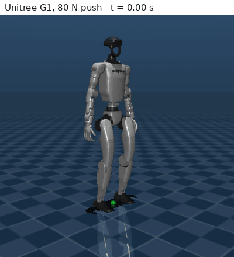
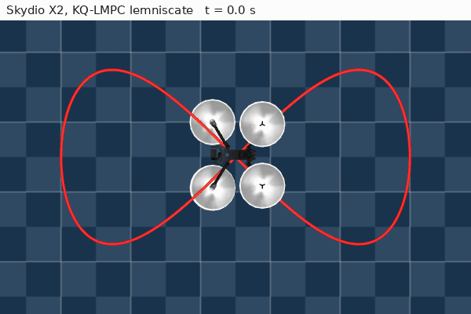
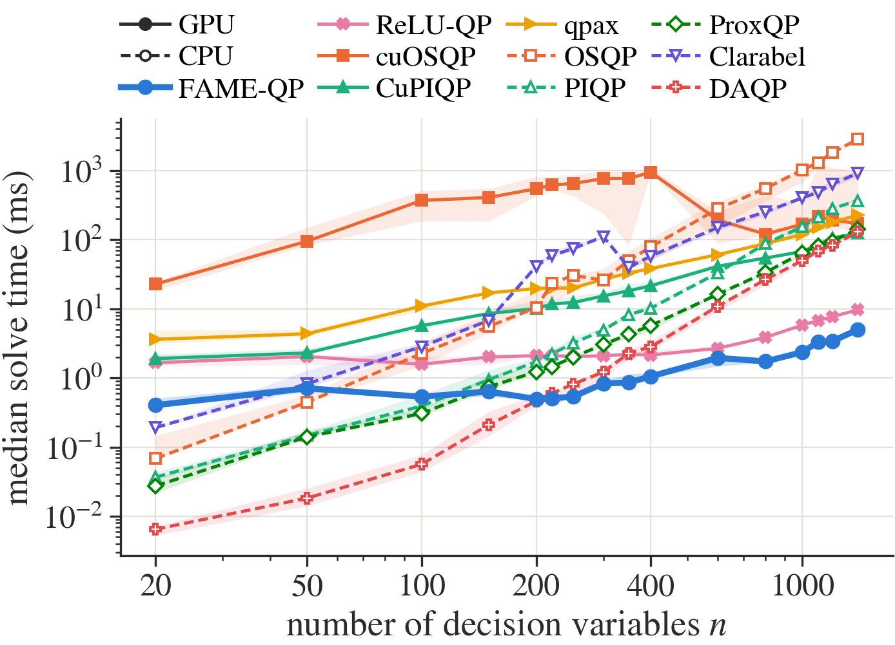
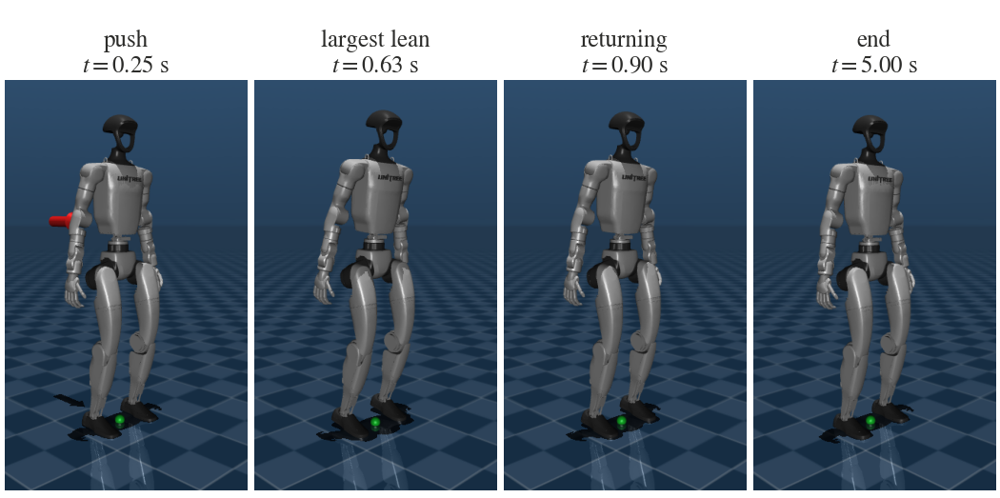
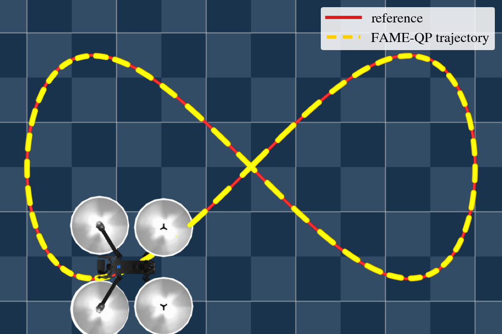

<h1 align="center">FAME&#8209;QP</h1>

<p align="center">
  <b>Fused ADMM with Multimode Execution: a GPU QP solver for real-time model predictive control</b><br>
  Dense convex QPs solved on the GPU with fused kernels, CUDA-graph replay and automatic tuning to your device.
</p>

<p align="center">
  <a href="https://pypi.org/project/fame-qp/"></a>
  
  
  <a href="https://github.com/santoshrajkumar/fame-qp/blob/main/LICENSE"></a>
  <a href="https://arxiv.org/abs/2611.13766"></a>
</p>

<p align="center">
  
  
</p>
<p align="center"><sub><b>Left:</b> Unitree G1 humanoid in MuJoCo recovering from an 80&nbsp;N push; its 290-variable MPC QP is solved every 2&nbsp;ms. <b>Right:</b> Skydio X2 tracking a lemniscate with KQ&#8209;LMPC; the QP's matrices change at every 20&nbsp;ms step. Red: reference, yellow: flown path.</sub></p>

---

## What this is

FAME&#8209;QP solves convex quadratic programs

```
minimize    ½ zᵀPz + qᵀz
subject to  l ≤ Gz ≤ h
```

on NVIDIA GPUs, with the dense QPs of linear MPC as the target. It runs the
ADMM iteration of OSQP with pre-inverted linear systems, and is built around how
that iteration executes on a GPU:

- **Constraint-dependent operators.** Constraint rows that act on single
  variables (input bounds, for example) are handled element-wise instead of as
  dense rows. This cuts operator storage by up to 4&times; and iteration time
  by up to 3&times; compared with treating every row as dense.
- **Fused single- and two-kernel iterations, replayed in CUDA graphs.** A whole
  ADMM iteration runs in one or two kernels, and blocks of iterations with the
  stopping test are replayed with a single host call.
- **Automatic selection.** A one-time device calibration and a short timing
  test per problem shape choose the execution mode, its tile sizes and,
  optionally, the precision.
- **Penalty probing and lazy updates.** A bank of pre-inverted operators gives
  penalty adaptation without refactorisation and a probed starting penalty;
  when the QP matrices change, only the operator in use is re-inverted.

The method and experiments are described in the
[paper](https://arxiv.org/abs/2611.13766).

<p align="center">
  <a href="https://github.com/santoshrajkumar/fame-qp/blob/main/examples/quick_demo.ipynb"></a><br>
  <sub>The paper's figures and tables, regenerated from the saved results, and the experiments running live on your GPU.</sub>
</p>

## Results

From the paper, on an RTX 3080 Laptop GPU in `float64`:

| Benchmark | FAME&#8209;QP |
|---|---|
| **Random dense QPs**, n = 20&ndash;1400, matched accuracy | Fastest GPU solver at every size, and faster than every CPU solver for n &ge; 220: 1.5&ndash;4.3&times; faster than ReLU-QP and 1.2&ndash;25.9&times; faster than DAQP |
| **Closed-loop MPC on random linear systems**, n = 400&ndash;2000 | 0.66&ndash;4.2 ms per step: 3.2&ndash;7.3&times; faster than ReLU-QP and 3.2&ndash;13.8&times; faster than &pi;MPC |
| **Unitree G1 push recovery**, 2 ms control period | 2.3&ndash;3.1&times; faster than ReLU-QP; stays within the period up to a horizon of N = 20, where ReLU-QP manages N = 10 |
| **Skydio X2 KQ&#8209;LMPC**, QP matrices change every step | 12.5 ms against 59.2 ms for CuPIQP (4.7&times;), with a 99th percentile of 17.6 ms within the 20 ms period |

<p align="center">
  
</p>
<p align="center"><sub>Cold-solve times on dense random QPs at matched accuracy, excluding setup: medians with min&ndash;max bands over five instances. All solvers in <code>float64</code> except cuOSQP (<code>float32</code>).</sub></p>

<table align="center" width="100%">
  <tr>
    <td width="55%" align="center">
      <br>
      <sub><b>Unitree G1</b>: push, largest lean, return and final stance.</sub>
    </td>
    <td width="45%" align="center">
      <br>
      <sub><b>Skydio X2</b>: 20 s of lemniscate tracking, 2.7 mm RMSE.</sub>
    </td>
  </tr>
</table>

---

## The paper

> **FAME-QP: A GPU-Accelerated Quadratic-Programming Solver for Real-Time Model Predictive Control**<br>
> S. M. Rajkumar, D. Goswami and S. Stockar<br>
> [arXiv:2611.13766](https://arxiv.org/abs/2611.13766), 2026.

```bibtex
@misc{rajkumar2026fameqp,
  title         = {{FAME-QP}: A {GPU}-Accelerated Quadratic-Programming Solver for Real-Time Model Predictive Control},
  author        = {Rajkumar, Santosh Mohan and Goswami, Debdipta and Stockar, Stephanie},
  year          = {2026},
  eprint        = {2611.13766},
  archivePrefix = {arXiv},
  primaryClass  = {cs.RO},
  url           = {https://arxiv.org/abs/2611.13766}
}
```

If you use FAME&#8209;QP, please cite the paper.

---

## Installation

```bash
pip install fame-qp
```

Requires Linux, an NVIDIA GPU supported by Triton, Python 3.9+, and PyTorch with
CUDA (Triton comes with it). If you need a particular CUDA build of PyTorch,
install it from [pytorch.org](https://pytorch.org) first.

From source:

```bash
git clone https://github.com/santoshrajkumar/fame-qp.git
cd fame-qp
pip install -e .
```

---

## Quick start

```python
from fame_qp import QP, Solver

qp = QP.create(P, q, G, l, h, device="cuda")       # G=None means l <= z <= h
solver = Solver(qp, precision="float64", eps_abs=1e-4, eps_rel=1e-4)
res = solver.solve()
res.z, res.lam, res.status, res.iters, res.info["mode"]

solver.update(q=q2, l=l2, h=h2)       # new data: setup and last solution are reused
solver.update_matrices(P=P2, G=G2)    # new matrices with the same constraint structure
res = solver.solve()
```

Linear MPC in condensed form, with shifted warm starts:

```python
from fame_qp.mpc import LinearMPC

mpc = LinearMPC(A, B, Q, R, Q_N, N=40, u_lo=-1, u_hi=1, x_lo=-2, x_hi=2)
ctrl = mpc.controller(x, precision="float64")
for _ in range(steps):
    u = ctrl.step(x)                  # updates the QP for x, warm starts and solves
    x = A @ x + B @ u
```

The first setup on a new GPU calibrates it (about a second), and the result is
cached for later runs.

### Examples

| | |
|---|---|
| [`examples/usage.py`](https://github.com/santoshrajkumar/fame-qp/blob/main/examples/usage.py) | The basic API: a QP, its solution and multipliers, updates between solves, box constraints and a small MPC loop |
| [`examples/demo.py`](https://github.com/santoshrajkumar/fame-qp/blob/main/examples/demo.py) | A random QP with n = 1000, closed-loop MPC on a random linear system, and the same MPC with A and B changing at every step |
| [`examples/quick_demo.ipynb`](https://github.com/santoshrajkumar/fame-qp/blob/main/examples/quick_demo.ipynb) | The paper's figures and tables from the saved results, plus live runs of the experiments on your GPU |

`fame_qp.utils` generates the paper's benchmark problems, seeded as in ReLU-QP:

```python
from fame_qp.utils import random_qp, random_lmpc

qp = QP.create(**random_qp(n=400, seed=0))   # n/4 dense equalities, n/4 one-sided inequalities
prob = random_lmpc(n_u=10, N=40)             # LQR-preconditioned condensed LMPC, n_x = 3 n_u
```

---

## How it works

Each ADMM iteration, in the form used by OSQP, is

```
z~   = M (σz − q + Gᵀ(ρ∘s − λ)),     M = (P + σI + Gᵀ diag(ρ) G)⁻¹
z    = α z~ + (1 − α) z
ζ    = α G z~ + (1 − α) s + ρ⁻¹∘λ
s    = clip(ζ, l, h),     λ = ρ∘(ζ − s)
```

and the solve stops when the unscaled primal and dual residuals fall below
`eps_abs + eps_rel × scale`. The rows of G are split into diagonal rows and dense
rows, giving three **structures**: *box* (`G = diag(d)`), *split*
(`G = [diag(d); C]` or `[C; diag(d)]`) and *general*.

<details>
<summary><b>Execution modes</b></summary>

| Mode | Iteration |
|---|---|
| `single_kernel` | One kernel per iteration on the stacked operator `W = S M Sᵀ`, `S = [I; C]`, with (n+m_c)² entries. Blocks of `check_interval` iterations and the on-device stopping test are replayed as a CUDA graph. |
| `two_kernel` | Two dependent kernels per iteration on the factored operator `[M, M Cᵀ]` plus `C`: n(n+2m_c) entries, exactly m_c² fewer, for one more launch. Replayed the same way. |
| `persistent` | Box structure, small n: the whole solve in one kernel launch with the operator held in registers. The penalty adapts between launches. |

`mode="auto"` (default) chooses; force a mode with `Solver(qp, mode=...)`.
</details>

<details>
<summary><b>Automatic selection</b></summary>

1. **Calibration**, once per device and precision (about a second): the cost of a
   kernel node in a replayed graph, of a host read, and of streaming operators of
   0.25&ndash;64 MB, plus the largest persistent-kernel tile that does not spill
   registers.
2. **Setup test**, once per problem shape: both forms are predicted from the
   calibration; forms that do not fit in memory or are predicted more than
   1.5&times; slower than the best are dropped, and the rest are timed on
   placeholder operators with their tiles tuned. The single kernel is kept
   unless two kernels are more than 10 % faster.
3. **Persistent kernel or graph replay**, from the predicted solve time using the
   iteration count of the penalty probe.
</details>

<details>
<summary><b>Precision</b></summary>

`precision="float32"` (default), `"float64"` or `"auto"`. With `"auto"`, κ(K) is
estimated by power iterations: `u₃₂κ ≤ 0.01ε` selects float32 and `u₃₂κ ≥ ε`
float64; in between, both precisions are probed and the one with the shorter
predicted solve wins, preferring float64 within 20 %. The operators are always inverted
in float64.
</details>

<details>
<summary><b>Penalty bank and updates</b></summary>

Operators are pre-inverted for five penalties ρ spaced by factors of 10, so
OSQP's residual-balancing adaptation switches operators instead of
refactorising. At setup, each penalty is probed with a short trial solve, and
the bank is re-centred if the best start is at an end; in the split structure
the ratio between the dense-row and diagonal-row penalties is probed as well.
`update` changes q and the bounds; `update_matrices` replaces P or G and
re-inverts the bank, or only the operator in use with `lazy_update=True`.
`warm_start_shifted` shifts the last solution one stage along the horizon.
</details>

<details>
<summary><b>Cache</b></summary>

Calibrations and mode choices are stored in `$FAME_QP_CACHE`, else
`$XDG_CACHE_HOME/fame_qp`, else `~/.cache/fame_qp`, keyed by the GPU, driver,
CUDA, Triton and FAME&#8209;QP versions. `fame_qp.clear_cache()` forgets them;
`Solver(qp, retune=True)` measures again.
</details>

---

## Reproducing the paper

[`examples/quick_demo.ipynb`](https://github.com/santoshrajkumar/fame-qp/blob/main/examples/quick_demo.ipynb)
regenerates the figures and tables of the experimental results from the saved
benchmark results, and runs short versions of the experiments live. The
benchmark scripts, the pinned baselines and their setup are in
[`experiments/`](https://github.com/santoshrajkumar/fame-qp/blob/main/experiments/README.md).

Tests, which need a CUDA GPU and Clarabel:

```bash
pip install -e ".[test]"
python -m pytest -q tests
```

---

## Repository layout

```
fame_qp/                  the solver
├── problem.py            QP data and constraint-structure detection
├── scaling.py            Ruiz equilibration
├── operator.py           pre-inverted operator bank
├── kernels.py            Triton kernels: iterations, stopping test
├── calibration.py        device calibration and mode selection
├── solver.py             Solver, Settings, Result
├── warmstart.py          shifted warm starts
├── mpc.py                condensed linear MPC
└── utils/                benchmark problem generators

examples/                 usage.py, demo.py, quick_demo.ipynb
experiments/              the paper's benchmarks and baselines
tests/                    unit tests
data_repo/                figures and animations for this page
```

## License

MIT &mdash; see [LICENSE](https://github.com/santoshrajkumar/fame-qp/blob/main/LICENSE).

<p align="center"><sub>Go Buckeyes! 🌰</sub></p>
